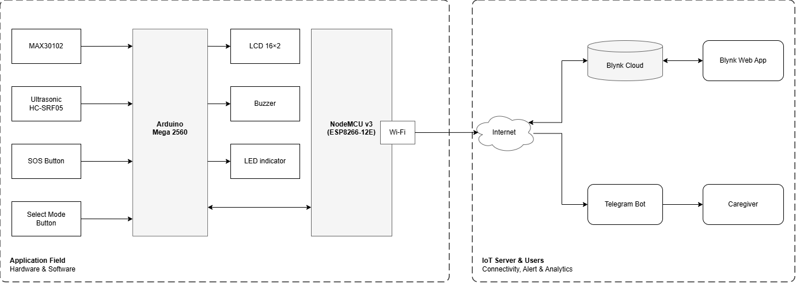
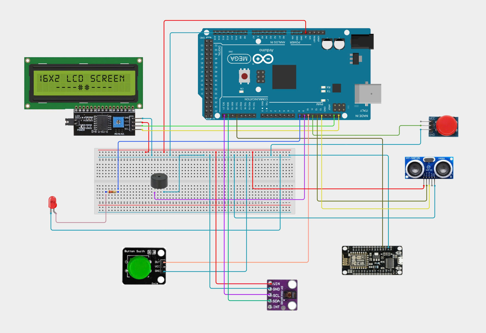

# IoT-Based Remote Health Monitoring System
> **Course:** IOT102 - Internet of Things | **FPT University (FPTU)**

---

## 1. Project Overview

With the growing need for remote patient monitoring and personal healthcare, the **IoT-Based Remote Health Monitoring System** is designed to measure and track vital signs-specifically **Heart Rate (BPM)** and **Blood Oxygen Saturation (SpO2)**-continuously, accurately, and in real time.

The system utilizes a dual-microcontroller architecture:
- **Local Edge Processing** on the primary microcontroller (Arduino Mega 2560) handles sensor data acquisition, signal processing, safety threshold verification, and local alert indicators.
- **Wireless IoT Gateway** powered by the NodeMCU ESP8266 manages Wi-Fi connectivity, synchronizes live metrics with the **Blynk IoT Cloud**, and dispatches instant alert notifications via **Telegram Bot API**.

This setup ensures that family members, caregivers, and medical practitioners can track vital health metrics from anywhere, receiving immediate notifications during abnormal physiological events or emergency situations.

---

## 2. Core Use Cases

The project implements and fulfills five primary practical use cases:

### Use Case 1: Vital Signs Measurement, LCD Display & Telegram Alert
- Measures Heart Rate (BPM) and Blood Oxygen Saturation (SpO2) using the MAX30102 pulse oximeter optical sensor.
- Displays real-time readings, operational status, and alerts on an I2C 16x2 LCD display.
- Automatically triggers local alerts (LED & Buzzer) and sends immediate warning messages through a **Telegram Bot** when readings exceed designated safe physiological thresholds.

### Use Case 2: Real-Time Tracking & Historical Analytics via Blynk
- Streams live telemetry data to the **Blynk IoT Cloud**.
- Provides users and caregivers with interactive dashboards (Gauges, Value Displays, and SuperCharts) accessible through the Blynk Mobile App and Web Console.
- Maintains historical measurement records to evaluate health trends over time.

### Use Case 3: Emergency SOS Alarm & Notification
- Features a dedicated physical **SOS button** for patients needing urgent assistance (e.g., sudden dizziness, breathing difficulty, or accidental falls).
- Instantly activates the highest priority routine: sounds a loud local siren pattern and sends an urgent **SOS Emergency Alert** directly to Telegram recipients.

### Use Case 4: Smart Proximity-Based Auto Wake-Up & Standby
- Uses a proximity/distance sensor to detect when a user's hand approaches the device.
- Automatically wakes up the system and turns on the LCD backlight to start the measurement cycle.
- Automatically dims/turns off the LCD backlight and enters a low-power **Standby Mode** when inactive, conserving energy during idle periods.

### Use Case 5: Age-Group Profile Selection & Adaptive Thresholds
- Enables users to switch between three physiological profiles: **Children**, **Adults**, and **Elderly**.
- Dynamically adjusts the safety thresholds for Heart Rate and SpO2 according to clinical norms for each age category, minimizing false alarms and ensuring accurate risk detection.

---

## 3. System Architecture

### 3.1. Block Diagram



### 3.2. Inter-Module Communication & Data Protocols

- **Sensor Bus:** I2C interface (SDA / SCL) connecting the Arduino Mega 2560 to the MAX30102 sensor and LCD controller (PCF8574).
- **Inter-Board Telemetry (UART):** Standard serial protocol at 115200 baud connecting Arduino Mega 2560 (Serial1: TX1 Pin 18) to NodeMCU ESP8266 (RX Pin). Data frames are structured as compact newline-delimited JSON payloads:
  ```json
  {
    "bpm": 76,
    "spo2": 98,
    "finger": true,
    "age_group": 1,
    "sos": false,
    "alert": false
  }
  ```
- **Cloud Protocols:**
  - **Blynk IoT:** Low-latency bi-directional TCP/SSL stream synchronizing parameters to Virtual Pins (`V0`: BPM, `V1`: SpO2, `V2`: Age Group, `V3`: System Status).
  - **Telegram Bot API:** Secure HTTPS requests to broadcast emergency notifications and abnormal vital warnings directly to designated chat IDs.

---

## 4. Age-Based Physiological Thresholds

Clinical safe intervals vary across age demographics. The system dynamically enforces these threshold limits:

| Age Profile | Code Identifier | Normal Heart Rate (BPM) | Minimum SpO2 (%) | Clinical Reference |
| :--- | :---: | :---: | :---: | :--- |
| **Children** | `CHLD` | 75 - 120 | >= 95% | Higher resting metabolic and heart rates in pediatric physiology. |
| **Adults** | `ADLT` | 60 - 100 | >= 95% | Standard clinical resting heart rate for healthy adults. |
| **Elderly** | `ELDR` | 55 - 90 | >= 94% | Slower baseline resting heart rate and slightly reduced natural oxygenation. |

---

## 5. Hardware Specifications & Circuit Design

### 5.1. Bill of Materials (BOM)

| # | Component | Description & Role | Interface / Connection |
| :-: | :--- | :--- | :--- |
| 1 | **Arduino Mega 2560** | Main processing unit: acquires sensor signals, computes algorithms, drives local indicators | I2C (Pin 20/21), UART1 (Pin 18 TX1) |
| 2 | **NodeMCU ESP8266 (v3)** | Wireless IoT gateway: receives JSON stream, manages Wi-Fi, Blynk, and Telegram alerts | UART (RX), 2.4 GHz Wi-Fi (802.11 b/g/n) |
| 3 | **MAX30102 Sensor** | High-sensitivity pulse oximetry and heart rate biosensor module | I2C (SDA, SCL, Vin 3.3V/5V) |
| 4 | **16x2 LCD + I2C Backpack** | Local user interface displaying BPM, SpO2, finger placement, and active profile | I2C (Address 0x21 or 0x27) |
| 5 | **Distance / Proximity Sensor** | Ultrasonic (HC-SR04) for hand detection (Auto Wake-up) | Digital I/O (Trig, Echo) or Analog |
| 6 | **Emergency SOS Button** | Momentary push button for instant emergency alarm activation | Digital Input with internal pull-up |
| 7 | **Age Selector Button** | Push button to cycle between Child, Adult, and Elderly profiles | Digital Input with debouncing |
| 8 | **Active Buzzer & Alert LED** | Audible buzzer and visual indicator for local out-of-range alarms and SOS sirens | Digital Output (Pin 8, Pin 9) |
| 9 | **Power Supply & Breadboard** | 5V DC power source, breadboard, and jumper wiring harness | - |

### 5.2. Circuit Schematic & Wiring Diagram



---

## 6. Repository Structure

```text
IoT-Based-Remote-Health-Monitoring-System/
├── README.md                           # Comprehensive project documentation
├── .gitignore                          # Build artifacts and temporary files exclusion
├── Mainboard/                          # Firmware for Arduino Mega 2560
│   ├── Pluse_Oximeter.ino              # Main edge firmware (PPG acquisition, LCD, JSON dispatch)
│   ├── CircularBuffer.h / .tpp         # Circular buffer utility for signal sampling
│   ├── MAX30100*.h / .cpp              # PPG register definitions and auxiliary driver files
│   └── ...
└── WifiModule/                         # Firmware for NodeMCU ESP8266
    └── CodeOxySensorWithLCD.ino        # Gateway firmware (UART parser, Wi-Fi, Blynk, Telegram client)
```

---

## 7. Project Information

- **Course:** IOT102 - Internet of Things
- **Institution:** FPT University (FPTU)
- **Domain:** Smart Healthcare & Remote Patient Monitoring (RPM)
- **Objective:** Developing a low-cost, reliable, and accessible IoT health monitoring device for remote home care and clinical assistance.
